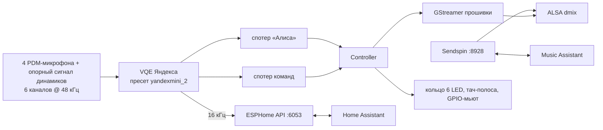

# pulsar — Яндекс Станция Мини 2

Яндекс Станция Мини 2 (`yandex,station-mini2`) как локальный голосовой спутник и умная колонка для
[Home Assistant](https://www.home-assistant.io/) — без облака Яндекса.

> **Статус: экспериментальная поддержка.** Демон проверен на живой колонке с прошивкой
> `0.369.1.46.4778262943.20261013.299`: активационная фраза → конвейер Home Assistant → TTS,
> воспроизведение через GStreamer прошивки, поток Music Assistant (FLAC через Sendspin), кольцо,
> сенсорные кнопки и свайпы, громкость, аппаратное отключение микрофонов, установка и снос
> хост-скриптами, автозапуск после перезагрузки. Не проверены: установка готовым установщиком,
> часы (не горят — см. «Ограничения»), качество распознавания (модели споттера в репозитории — от
> Лайт 2), сопряжение Sendspin.

Вместо штатного стека Яндекса (`maind`) на колонке работает небольшой нативный демон. Он говорит с
Home Assistant по протоколу ESPHome Native API и выглядит в HA как обычное ESPHome-устройство.
Для [Music Assistant](https://music-assistant.io/) он дополнительно является нативным
[Sendspin](https://www.sendspin-audio.com/)-плеером.

Проект поддерживает также Миди (`cucumber`) и Лайт 2 (`plum`); этот README описывает только Мини 2.
Код моделей общий, поэтому всё, что относится к Миди и Лайт 2, лежит в `src/model.cpp`,
`src/zigbee/` и `radio/`.

Железо Мини 2 используется полностью и штатными средствами прошивки:

- **«Алиса» / «Яндекс»** — родная модель активационной фразы Яндекса и родное
  шумоподавление/эхоподавление (VQE, пресет `yandexmini_2`) по четырём микрофонам с вычитанием
  звука собственных динамиков.
- **Локальные голосовые команды** — «стоп», «громче», «тише», «продолжи», «дальше» и т. д.
  выполняются на самой колонке, без HA (родная модель команд Яндекса).
- **Отвечает ближайшая колонка** — если «Алису» услышали несколько колонок с pulsar, отвечает та,
  что услышала громче.
- **Динамики** — воспроизведение HTTP-потоков через GStreamer прошивки; громкость — регулятор
  `Master` на `default` (softvol поверх dmix).
- **Кольцо из 6 светодиодов** (sysfs `mini2:<цвет>:ring1..6`) и **тач-полоса из трёх зон**:
  громкость −, кнопка действия, громкость +; жест, проведённый по всей полосе, переключает трек.
- **Аппаратный выключатель микрофонов** — кнопка с фиксацией в цепи микрофонов, состояние читается
  с GPIOZ_3.
- **Sendspin** — плеер Music Assistant: музыка идёт без потерь (FLAC), громкость и голосовые
  команды колонки управляют плеером MA.
- Чего у Мини 2 нет: часов (контроллер светодиодов часов не поднимается на прошивке), датчика
  освещённости, логотипа на кольце и Zigbee-модуля.

Ни одна проприетарная библиотека Яндекса в репозитории не распространяется: демон загружает их с
самой колонки во время работы.

> Проект не связан с Яндексом. Всё, что вы делаете с устройством, — на ваш страх и риск.

## Что появляется в Home Assistant

| Сущность | Что делает |
|---|---|
| Assist satellite | Голосовой ассистент: активационные фразы «Алиса» / «Яндекс», таймеры, объявления (`assist_satellite.announce`), продолжение диалога |
| Media player | Воспроизведение медиа и TTS, громкость, mute (полная тишина: музыка, ответы, объявления и звуки колонки); при обрыве сети поток переподключается (3 попытки) с того же места; виден в Music Assistant через провайдер «Home Assistant». Если играет Sendspin-поток Music Assistant, play/pause/stop из HA управляют группой MA так же, как голосовые команды |
| Switch «Mute microphones» | Программное отключение микрофонов |
| Light «Ring» | Кольцо как обычная лампа: цвет, яркость, эффекты Rainbow / Breathe |
| Binary sensor «Hardware mic mute» | Аппаратный выключатель микрофонов на корпусе |
| Event «Button» | `action`, `volume_up`, `volume_down` — для автоматизаций |
| Button «Restart» | Перезапуск демона на колонке |
| Update «Firmware» | Новая версия pulsar из GitHub Releases: «Установить» в HA (см. «Обновление из Home Assistant») |
| Switch «Auto update» | Ставить новые версии автоматически (по умолчанию выключен) |
| Switch «Nearest station answers» | Отвечает ближайшая колонка (по умолчанию включён, см. «Несколько колонок») |
| Диагностика | «Wi-Fi signal» (дБм), «Uptime», «IP address», «Version» |

Часов и датчика освещённости у Мини 2 нет, поэтому сущности «Clock display», «Clock brightness»,
«Clock text», «Clock face», «Clock text speed», действия `clock_show_*` и сенсор «Illuminance»
в HA не появляются; яркость кольца задаётся только лампой «Ring», автоматически она не
подстраивается.

Время и часовой пояс приходят из Home Assistant. Обратного отсчёта на Мини 2 не видно
(нет часов): сработавший таймер звенит кольцом, выключается кнопкой действия или голосовой
командой «стоп». Журнал демона виден в HA (журналы устройства ESPHome). К колонке могут
одновременно подключаться несколько клиентов (до 4), например HA и ESPHome Dashboard; голосовой
конвейер обслуживает последний подписавшийся на него клиент, а когда тот отключается или
отписывается — снова предыдущий (обычно HA). Если HA не продвигает диалог (30 с прослушивания или
120 с обработки без событий), колонка сама завершает его и показывает ошибку на кольце.

### Кнопки и индикация

- **Кнопка действия:** короткое нажатие — начать диалог без активационной фразы; во время ответа —
  прервать его; при звонке таймера — выключить; во время запроса сопряжения Sendspin — подтвердить
  сопряжение. Долгое нажатие — пауза/продолжение музыки, как play/pause; событие в HA не
  отправляется (состояние и так видно в медиаплеере).
- **Громкость +/−:** шаг 5 %, уровень показывается на кольце белой шкалой от первого светодиода.
  Шкала громкости та же, что у штатной прошивки: 5 % — одна её ступень, 10 % в HA соответствует
  «1» у Алисы.
- **Свайп по тач-полосе:** проведите пальцем по всем трём зонам слева направо (громкость −, кнопка
  действия, громкость +) — следующий трек, справа налево — предыдущий. Работает в очереди
  Sendspin (Music Assistant); громкость, которую успела изменить первая зона, возвращается,
  кольцо показывает комету в сторону жеста. Событие в HA не отправляется.
- **Кольцо:** короткая вспышка после «Алиса»; «слушаю» — ровное дыхание бирюзовым; «думаю» —
  синяя волна от домашнего светодиода в обе стороны; «отвечаю» — та же волна быстрее и ярче;
  звонок таймера; отключённые микрофоны — ровный красный; громкость — белая шкала; свайп — комета;
  долгое нажатие кнопки действия — плавная вспышка всего кольца. Красная вспышка после «Алиса»
  значит, что HA не подключён к колонке.

### Локальные голосовые команды

Распознаются без Home Assistant, пока что-то играет (музыка, ответ ассистента, объявление,
звонок таймера), в течение 2,5 с после «Алиса» и ещё минуту после того, как музыка остановилась
(поэтому «продолжи» работает после паузы): «Алиса, громче». В остальное время модель команд
выключена, чтобы разговор в комнате не давал ложных срабатываний.

| Фраза | Действие |
|---|---|
| стоп / хватит | выключить звонок таймера, иначе прервать ответ, иначе пауза музыки |
| пауза | пауза |
| продолжи / играй | продолжить воспроизведение |
| громче / тише | громкость ±10 % |
| дальше / следующий, назад | следующий / предыдущий трек (Sendspin) |

### Несколько колонок

Колонки с pulsar в одной сети договариваются, кто ответит: услышав активационную фразу, каждая
рассылает широковещательный UDP-пакет (порт 6054) с громкостью фразы и ждёт 250 мс пакетов
соседей. Отвечает колонка, которая услышала фразу громче, то есть обычно ближайшая; колонка, которая
в этот момент отвечает, читает объявление или звонит таймером, своё слово не уступает. На остальных
кольцо мигает и гаснет, звука нет, «Алиса, громче» меняет громкость только у ответившей. Звук
сигнала активации из-за ожидания запаздывает на эти 250 мс; сказанное сразу после «Алиса» не
теряется.

С выключенным «Nearest station answers» (или если пакеты не доходят: точка доступа режет
широковещательный трафик, колонки в разных подсетях) отвечает та, чей запрос первым дошёл до HA:
остальные HA отклоняет как повтор, и они молча гаснут. Другие голосовые спутники (Voice PE и т. п.)
в договорённости не участвуют.

## Требования

**Колонка:**

- Яндекс Станция Мини 2 с root-доступом по adb: `adb shell` от root, по сети или USB.
- Прошивка, на которой можно поставить автозапуск. Штатные способы рута Станций запускают при
  загрузке `/data/quasar/rootkeeper.sh` (строка `[ -x /data/quasar/rootkeeper.sh ] && ...` в
  `/system/vendor/quasar/onboot.sh`), и установщик дописывает в этот файл хук. На Мини 2 с
  прошивкой `0.369` такого рута нет (`activate_adb_*`-маркеры): `rootkeeper.sh` не существует, а
  `onboot.sh` его не вызывает. Тогда автозапуск делает хук в `/etc/init.d/S99quasar`; его ставит
  хост-скрипт установки этого порта (см. «Установка»). Сам рут в проект не входит.
- Проверено на прошивке `0.369.1.46.4778262943.20261013.299`. Профиль снят с той же прошивки.
- Обновление прошивки Яндекса перезаписывает rootfs: после него хук в `S99quasar` нужно поставить
  заново (копия оригинала в `/data/pulsar/S99quasar.orig` при этом сохраняется).

**Компьютер:** Windows, macOS или Linux в той же сети, что и колонка. Для установки готовым
установщиком ставить ничего не нужно — он сам скачает `adb` (см. «Установка»). Скриптам установки
этого порта нужны `bash` (Git Bash на Windows) или PowerShell и `adb` в `PATH`. Сборка из
исходников — только Linux или WSL2, см. «Сборка из исходников».

**Home Assistant** 2025.x или новее с интеграцией ESPHome и настроенным конвейером Assist
(STT/TTS с поддержкой русского).

## Установка

### Скрипты установки этого порта

Так ставилась и проверялась колонка, на которой обкатывался порт. Скрипты лежат в корне
репозитория: `pulsar-install.sh` для Linux/macOS/Git Bash и `pulsar-install.ps1` для Windows
(рядом — `pulsar-remove.sh` и `pulsar-remove.ps1`). Сначала соберите демон для armhf («Сборка из
исходников»), затем:

```sh
./pulsar-install.sh 192.168.1.50:5555            # серийник как в `adb devices`
./pulsar-install.sh 192.168.1.50:5555 --no-start # разложить файлы и автозагрузку, не запускать
./pulsar-install.sh 192.168.1.50:5555 --bin /путь/к/pulsar
```

```powershell
.\pulsar-install.ps1 192.168.1.50:5555
```

Скрипт:

1. определяет модель по `/proc/device-tree/compatible` и архитектуру (для `station-mini2` —
   armhf) и берёт `satellite/build/armhf/pulsar`, если не указан `--bin`;
2. заливает бинарник как `pulsar.new`, сверяет sha256 и сохраняет прежний как `pulsar.prev`;
3. атомарно заменяет `boot.sh`, `supervise.sh` и `ctl.sh` в `/data/pulsar`;
4. ставит автозапуск: в `rootkeeper.sh`, если прошивка его запускает, иначе дописывает вызов
   `boot.sh` в конец `/etc/init.d/S99quasar`. Rootfs на время записи перемонтируется в rw;
   оригинал `S99quasar` остаётся в `/data/pulsar/S99quasar.orig`; новый файл проверяется `sh -n`
   и sha256, после записи rootfs возвращается в ro. В `/system` не пишется ничего;
5. запускает демон (`ctl.sh enable` гасит штатный стек и поднимает супервизор);
6. через ~10 и ~30 с проверяет журнал и при неудаче предлагает вернуть `pulsar.prev`.

После каждой загрузки сначала поднимается штатная обвязка Яндекса (adbd, сеть, звук), затем
`boot.sh` дожидается `quasar_launcher2`, гасит её и запускает супервизор pulsar. Повторный запуск
обновляет установленную версию; `--yes` не задаёт вопросов, `--no-boot` не трогает автозагрузку.

### Готовый бинарник из релиза

Собирать самому не обязательно: в [релизах этого форка](https://github.com/ste4ik/pulsar/releases/latest)
лежит готовый `pulsar-armhf.bin` и `SHA256SUMS`. Установщик из релизов `Morvex885/pulsar` модель
`station-mini2` пока не знает, поэтому бинарник передаётся скрипту этого порта явно.

Linux и macOS:

```sh
curl -fLO https://github.com/ste4ik/pulsar/releases/latest/download/pulsar-armhf.bin
curl -fLO https://github.com/ste4ik/pulsar/releases/latest/download/SHA256SUMS
grep 'pulsar-armhf.bin$' SHA256SUMS | sha256sum -c -   # на macOS: shasum -a 256 pulsar-armhf.bin
./pulsar-install.sh 192.168.1.50:5555 --bin ./pulsar-armhf.bin
```

Windows (PowerShell):

```powershell
curl.exe -fLO https://github.com/ste4ik/pulsar/releases/latest/download/pulsar-armhf.bin
Get-FileHash .\pulsar-armhf.bin -Algorithm SHA256   # сверить со строкой в SHA256SUMS
.\pulsar-install.ps1 192.168.1.50:5555 -Bin .\pulsar-armhf.bin
```

`pulsar-armhf.debug` — необязательный файл с отладочными символами для `addr2line`. Установщик
меняет только `/data`; единственное исключение — хук автозагрузки в `S99quasar` на прошивке
`0.369`, описанный выше.

### Home Assistant

**Настройки → Устройства и службы**. Колонка обнаружится сама как ESPHome-устройство
`yandex-mini2-xxxxxx`. Если не обнаружилась, добавьте интеграцию ESPHome вручную с IP колонки и
портом `6053`; ключ шифрования HA создаст сам (см. «Шифрование API»). В настройках устройства
выберите конвейер Assist и активационную фразу.

### Обновление из Home Assistant

Колонка сама проверяет релизы [этого форка](https://github.com/ste4ik/pulsar/releases) через
минуту после запуска и затем каждые 6 часов; проверить сразу — «Проверить наличие обновлений» в HA
(`homeassistant.update_entity`). Учитываются только стабильные релизы (не пре-релизы). Когда
выходит новая версия, сущность «Firmware» в HA показывает её со ссылкой на релиз; кнопка
«Установить» ставит её. Колонка скачивает `pulsar-armhf.bin` по HTTPS (сертификат проверяется),
сверяет с `SHA256SUMS` релиза и проверяет, что программа запускается на этой колонке и сообщает
нужную версию. Только после этого она заменяет бинарник (прежний остаётся как `.prev`) и
перезапускается — разговор или музыка в этот момент прервутся.

С включённым переключателем «Auto update» колонка ставит новую версию сама, дождавшись тишины (нет
диалога, музыки, объявления или звонка таймера). Если новая версия не запустится, через
автоматический откат (см. «Управление») вернётся прежняя, и эту версию автообновление больше
ставить не будет; вручную её поставить можно. Обновление прошивки Яндекса, наоборот, сбрасывает
хук автозагрузки в `S99quasar` — его нужно поставить заново.

Сборки не из релиза (версия — хеш коммита, например `1fa4934`) обновление тоже видит, но
автоматически не обновляются: только кнопкой. Обновляется только демон; `boot.sh`, `supervise.sh`
и `ctl.sh` обновляет установщик.

Релизы этой сборки собраны с `UPDATE_REPO=ste4ik/pulsar`, поэтому «Firmware» в HA видит и ставит
именно релизы форка. Если собрать демон из исходников без этого флага, апдейтер будет смотреть на
`Morvex885/pulsar` — релизы upstream поддержки Мини 2 не содержат, ставить их на Мини 2 нельзя:
демон не найдёт модель и завершится. Собирайте с `UPDATE_REPO=ste4ik/pulsar` или обновляйтесь
вручную из [релизов форка](https://github.com/ste4ik/pulsar/releases/latest) тем же способом, что
и при установке.

### Music Assistant

Music Assistant с поддержкой Sendspin находит колонку сам: плеер «Яндекс Станция Мини 2» с типом
**Sendspin**. Музыка идёт без потерь (FLAC), громкость и голосовые команды колонки управляют
плеером MA. Синхронное воспроизведение в группах с другими Sendspin-плеерами заложено протоколом,
но пока не проверялось. Задержку вывода задают в настройках Sendspin-плеера в Music Assistant; MA
хранит её сам и присылает при каждом подключении.

По умолчанию колонка принимает Sendspin-подключения без сопряжения. Чтобы требовать сопряжение:

```sh
adb shell 'echo 0 > /data/pulsar/sendspin/unpaired_access'
adb shell /data/pulsar/ctl.sh restart
```

Дальше при запросе сопряжения кнопка действия подтверждает запрос (долгое нажатие в этот момент
тоже подтверждает, а не ставит музыку на паузу). Код сопряжения показывается на часах, которых у
Мини 2 нет; токен сопряжения печатается в журнал демона (`/data/pulsar/ctl.sh log`). Сопряжение
именно на Мини 2 ещё не проверялось.

### SSH (необязательно)

```sh
./pulsar-install --ssh            # установщик из релиза дополнительно поставит dropbear
```

Устанавливает dropbear в `/data/dropbear` на порт 22. **Вход под root с пустым паролем** (`-B`).
Ставьте только в доверенной сети или поменяйте флаги в `ssh/start.sh`.

## Windows и macOS

> Хост-скрипты и установщик для Windows и macOS на реальных компьютерах проверены не полностью.
> Если что-то не работает, напишите в issues.

- В Windows скрипт — `.\pulsar-install.ps1 <IP>:5555` (PowerShell). Если запустить скачанный
  установщик двойным щелчком, окно в конце ждёт Enter, чтобы можно было прочитать вывод.
- Архив, скачанный браузером и распакованный в Проводнике, может вызвать SmartScreen: «Система
  Windows защитила ваш компьютер» → «Подробнее» → «Выполнить в любом случае». У архива, скачанного
  через `curl.exe` и распакованного `tar`, такой пометки нет.
- Если `adb` уже есть в `PATH` (например, из Android Studio), используется он.
- Подключение колонки по USB не описано: используйте adb по сети.
- В macOS скачивайте архив через `curl`, как в «Установке». Для архива, уже скачанного браузером:
  `xattr -dr com.apple.quarantine pulsar`. Если поиск ничего не находит или adb пишет «No route to
  host», разрешите терминалу доступ к локальной сети: «Системные настройки» →
  «Конфиденциальность и безопасность» → «Локальная сеть».
- Сборка демона на macOS не поддерживается — используйте готовый бинарник или соберите на Linux.

## Сборка из исходников

Демон собирается на Linux или WSL2. Для Мини 2 нужна только 32-битная armhf-сборка; полная сборка
делает обе архитектуры. Нужны:

- [zig 0.14.1](https://ziglang.org/download/) — кросс-компилятор (Мини 2: 32-битный armhf/glibc
  2.30). zig 0.13 не подходит: собранные им 32-битные программы падают при запуске. Другой zig
  можно указать как `ZIG=/путь/к/zig`;
- `make`, `git`, `curl`, `cmake` ≥ 3.16, `ninja`, `patch`
  (cmake и ninja можно поставить через `uv tool install cmake ninja`);
- `adb` из Android platform-tools — для установки;
- [Go](https://go.dev/dl/) 1.27+ — только для готового установщика из репозитория, хост-скриптам
  он не нужен.

```sh
make -C satellite ARCH=armhf -j"$(nproc)"             # только Мини 2
make -C satellite -j"$(nproc)"                        # обе архитектуры
make -C satellite -j"$(nproc)" ZIG=~/opt/zig/zig      # или явно
```

Makefile отказывается работать с zig старше 0.14. Результат: `satellite/build/armhf/pulsar` (без
отладочной информации — его и ставит установщик) и рядом `pulsar.debug` с символами для разбора
отчётов о падениях. Версия берётся из `git describe` и видна в `pulsar --version` и в HA (сущность
«Version»).

При первой сборке скачиваются и собираются зависимости (sendspin-cpp и его библиотеки, заголовки
alsa-lib), все версии зафиксированы. Прошивки Zigbee-модуля (`radio/`) собираются только для Миди
и на Мини 2 не нужны. Каждый pull request и каждый push в `main` собираются в GitHub Actions
(обе архитектуры); готовые бинарники лежат в артефактах сборки, а для версий (теги `v*`) — в
Releases: архивы `pulsar-<ОС>-<arch>` для установки, бинарники обеих архитектур, `.debug`-файлы и
`SHA256SUMS`.

## Управление

На колонке (`adb shell` или ssh):

```sh
/data/pulsar/ctl.sh status    # кто сейчас работает: демон или стек Яндекса
/data/pulsar/ctl.sh log 100   # журнал (/tmp/pulsar.log)
/data/pulsar/ctl.sh restart
/data/pulsar/ctl.sh reload    # перезапустить и надзорный скрипт (после обновления supervise.sh)
/data/pulsar/ctl.sh api-key   # ключ шифрования API: показать / задать / clear
/data/pulsar/ctl.sh disable   # вернуть стек Яндекса, в том числе после перезагрузки
/data/pulsar/ctl.sh enable
/data/pulsar/pulsar --version
```

Журнал лежит в `/tmp` (обнуляется при перезагрузке), ротируется при 1 МБ; одинаковые подряд строки
сворачиваются в «last message repeated N times».

**Автоматический откат.** Демон перезапускается после падения через 3 с (пауза удваивается до
30 с). Если он 5 раз подряд падает, не проработав 5 минут, вместо него ставится `.prev` (сломанный
бинарник сохраняется как `.bad`); если падает и он — колонка возвращается стеку Яндекса, как после
`ctl.sh disable`. Перезапуск кнопкой «Restart» в HA или через `ctl.sh restart` падением не считается.
При падении в журнал пишется отчёт с адресами; разобрать его можно на компьютере:
`addr2line -f -e satellite/build/armhf/pulsar.debug <адреса>` (или `pulsar-armhf.debug` из релиза).

Откат на предыдущую версию вручную:

```sh
cd /data/pulsar && mv pulsar.prev pulsar && ./ctl.sh restart
```

Полное удаление: скрипт `pulsar-remove.sh` (или `pulsar-remove.ps1`) — он останавливает демон и
возвращает штатный стек, убирает **только свою** строку из `rootkeeper.sh` (если хук ставился туда)
и восстанавливает `/etc/init.d/S99quasar` из `/data/pulsar/S99quasar.orig` (rootfs на время записи —
rw, затем ro), после чего удаляет `/data/pulsar`. Вручную: `ctl.sh disable`, вернуть `S99quasar` из
сохранённой копии, удалить `/data/pulsar` и нашу строку хука из `/data/quasar/rootkeeper.sh`.

Настройки (громкость, свет, активационная фраза, автообновление) хранятся в
`/data/pulsar/state.conf`. Громкость записывается дважды: `volume2=` по шкале штатной прошивки и
`volume=` — та же громкость для прежних версий демона, так что после отката на `.prev` колонка
играет так же громко.

### Шифрование API

Колонка поддерживает шифрование ESPHome API (Noise), как обычные ESPHome-устройства. Пока ключа
нет, API работает без шифрования, и свежий Home Assistant при подключении сам создаёт ключ и
записывает его на колонку (`/data/pulsar/api_key`); дальше соединение шифруется.
Задать ключ вручную (base64 от 32 байт, как в ESPHome) или убрать его:

```sh
/data/pulsar/ctl.sh api-key <base64>   # затем ввести тот же ключ в HA
/data/pulsar/ctl.sh api-key clear
```

После смены или удаления ключа вручную HA попросит переавторизовать устройство. **Внимание:**
версии демона без поддержки шифрования (и откат на такую через `.prev`) не смогут общаться с HA,
который уже хранит ключ: удалите ключ в настройках устройства в HA или удалите и заново добавьте
устройство.

## Ограничения

- Пока HA не записал ключ шифрования, API открыт без шифрования любому в сети: добавьте колонку в
  HA сразу после установки (или задайте ключ через `ctl.sh api-key`).
- Колонка по-прежнему использует DNS (`unbound`) и NTP прошивки, которые настроены на серверы
  Яндекса, и остаётся привязанной к аккаунту Яндекса.
- **Часы не горят:** второй контроллер IS31FL3236 (i2c 0-003f) не поднимается на прошивке `0.369`
  (`register write to 0x4F failed (error -6)`). Дерево устройств в порядке, демон эти светодиоды не
  трогает; исправление — в прошивке или драйвере, без изменений кода.
- **Датчика освещённости нет** — яркость кольца не подстраивается по свету в комнате.
- **Логотипа на кольце нет**, **Zigbee-модуля нет**: соответствующие сущности и функции Миди на
  Мини 2 недоступны.
- Модели споттера в `spotter_models/` — от Лайт 2; качество распознавания на Мини 2 не измерялось.
- Код сопряжения Sendspin показывается на часах, которых у Мини 2 нет; токен сопряжения — только в
  журнале демона.
- Голос ответов — тот, что выбран в TTS Home Assistant; голоса Алисы нет.
- Обновление прошивки Яндекса сбрасывает хук автозагрузки в `S99quasar`; после OTA его нужно
  поставить заново (оригинал в `/data/pulsar/S99quasar.orig` сохраняется).

## Как это устроено



```
satellite/
  src/core/       event loop, логирование
  src/esphome/    ESPHome Native API (protobuf вручную), mDNS
  src/audio/      захват, VQE и спотеры Яндекса (через dlopen)
  src/media/      плеер на GStreamer прошивки, громкость
  src/sendspin/   Sendspin-плеер (sendspin-cpp)
  src/zigbee/     Zigbee-модуль Миди (на Мини 2 не используется)
  src/hw/         кольцо (sysfs), кнопки и свайпы, GPIO-мьют; часы и датчик света — для других моделей
  src/model.*     описание железа каждой модели, определение модели по devicetree
  src/controller.*  логика спутника и сущностей HA
  src/arbiter.*   договорённость между колонками, кто отвечает на активационную фразу (UDP 6054)
  deploy/         boot.sh / supervise.sh / ctl.sh (на колонке), dist.sh (архивы релиза)
  tools/          диагностические утилиты (зонд железа, офлайн-тест спотера, тест API)
  third_party/    закреплённые версии зависимостей и тулчейн zig для CMake
installer/        установщик pulsar-install (Go): поиск колонок, adb, установка, миграция
radio/            прошивки Zigbee-модуля Миди (на Мини 2 не нужны)
ssh/              сборка и запуск dropbear
```

## Лицензия

[MIT](LICENSE). Сторонние библиотеки, которые скачиваются при сборке, распространяются под своими
лицензиями: sendspin-cpp, ArduinoJson, noise-c, IXWebSocket, micro-flac, micro-opus, alsa-lib,
dropbear, OpenSSH. Установщик написан на Go (стандартная библиотека и `golang.org/x/net`,
лицензия BSD). `adb` в архивы не входит: установщик скачивает Android SDK Platform-Tools с сайта
Google, они распространяются на условиях Google.
